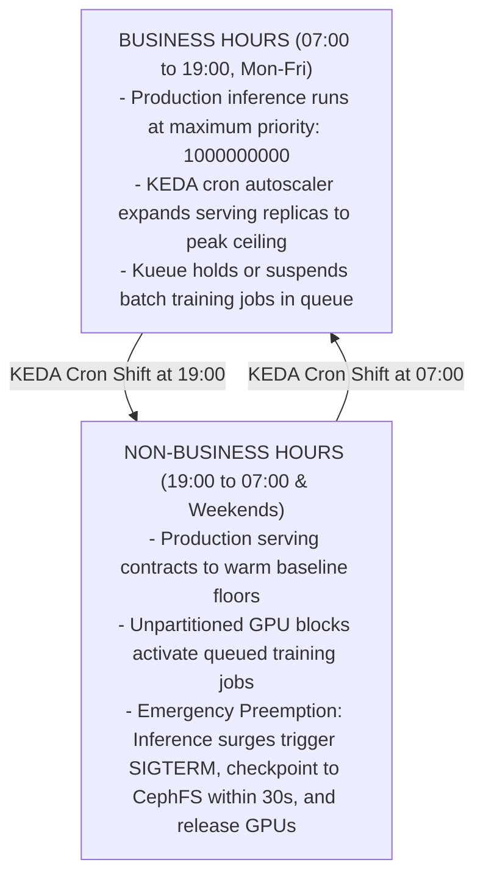

# SKILL: Enterprise AI Workload Resource Allocator & Capacity Planner

## Name
ai-workload-resource-allocator

## Description
Jointly reads and cross-references workload-specification.yaml and resource_specification.yaml. Filters out workloads marked with ignore: true. Evaluates raw cluster node inventories and accelerator catalog specs (NVIDIA Blackwell, Hopper, Ada, Ampere; AMD Instinct; Intel Gaudi). Dynamically calculates the optimal partitioning_applied strategy (MIG profiles, Time-Slicing slices, or full unpartitioned devices) per physical node, balances temporal capacity shifts between business and off-hours (KEDA + Kueue), and generates complete OpenShift AI deployment manifests. Filters out any workload marked with ignore: true. Translates reference A100 training benchmarks into target hardware scaling speedups and ensures target blended GPU saturation (80% to 85% or higher) while enforcing strict priority for production inference.

---

## 1. Input Ingestion and Filtering Rules

When invoked, the agent must load and cross-reference both input files:

1. Ingest workload-specification.yaml:
   - Iterate through workload_types.
   - IF ignore == true: Completely omit the workload from compute, memory, and queue allocations. Log: "[IGNORED WORKLOAD]: <key> excluded by specification directive."
   - IF ignore == false: Ingest into active demand set.
2. Ingest resource_specification.yaml:
   - Parse accelerator_catalog: Extract compute TFLOPS, VRAM capacity, memory bandwidth, interconnect type/speed, and partitioning_capabilities (MIG profiles vs. Time-Slicing).
   - Parse topology: Extract datacenters, WAN constraints, storage fabrics (ODF CephFS RWX capacity), and physical nodes with installed accelerator counts.
3. Validate Cross-References:
   - Match every node.accelerator_configuration.catalog_ref in topology against a valid entry in accelerator_catalog.
   - Verify that model runtimes in workload-specification match recommended_runtimes for the target accelerator.

---

## 2. Dynamic Hardware Partitioning Engine

The agent must calculate and synthesize the a partitioning configuration for each physical node based on active workload demands:

### A. Architectural Partitioning Rules
1. Tensor Parallelism and Distributed Training Interconnect Check:
   - IF a workload requires Tensor Parallelism (TP >= 2) or multi-GPU distributed training (FSDP / DeepSpeed ZeRO-3):
     Target only accelerators featuring high-speed NVLink, Infinity Fabric, or integrated RoCE (e.g., nvidia_h100_sxm, nvidia_h200, nvidia_b200, amd_instinct_mi300x).
     Enforce partitioning mode: "full" (zero MIG on those physical devices) because MIG disables peer-to-peer interconnect crossbars.
2. Hardware MIG Slicing (MIG-Capable Accelerators):
   - IF accelerator supports MIG (mig_supported == true) AND active workloads include multi-tenant Jupyter developer workbenches, lightweight LLMs (7B-14B), or dedicated audio transcription:
     Calculate discrete MIG profiles from mig_profiles:
     - 3g.40gb (or 3g.70gb / 3g.96gb): Allocate for developer workbenches (isolated VRAM) or single-GPU 7B-14B LLM serving.
     - 1g.10gb (or 1g.20gb / 1g.24gb): Allocate for vector embedding inference (TEI), TTS speech synthesis, or safety guardrail sidecars.
3. Time-Slicing Multiplexing (Non-MIG Accelerators):
   - IF accelerator does NOT support MIG (e.g., nvidia_l40s, nvidia_l4) AND hosts stateless microservices:
     Enforce partitioning mode: "time_slicing".
     Calculate time_slice_replicas: default to 4 (e.g., 4x slicing on a 48GB card provides 4 logical devices with 12GB operational targets).
     Enforce container memory limits (--gpu-memory-utilization 0.40 in vLLM) to prevent CUDA Out-of-Memory faults.
4. Active-Active Failover Landing Zone:
   - Guarantee that if Node 1 runs a flagship model on 4 unpartitioned accelerators, Node 2 reserves 4 matching unpartitioned accelerators (running low-priority preemptible training during normal operations) to serve as the immediate failover landing zone.

## 2. Hardware Placement and Sizing Logic

For all active workloads (ignore == false), apply the following compute placement rules:

### A. Compute Class Alignment
1. High-Throughput Distributed Training and Multi-GPU Reasoning (Tensor Parallelism >= 2):
   - Workload Candidates: llm_flagship_orchestrator, llm_foundational[cite: 1], large-scale stt[cite: 1].
   - Target Hardware: DC1 H100 SXM5 nodes (leveraging 900 GB/s NVLink and 3,350 GB/s HBM3 memory bandwidth).
2. Single-GPU Serving, Vision Processing, and Coding Assistants:
   - Workload Candidates: vision[cite: 1], code_assistant, document_vlm, agentic_slm.
   - Target Hardware: DC2 L40S PCIe nodes (leveraging 48GB GDDR6 memory and FP8 Transformer Engines on single GPUs without inter-card NVLink communication overhead).
3. Microservices and Gateway Sidecar Tasks:
   - Workload Candidates: safety_guardrails, vector_embeddings_reranking, tts[cite: 1].
   - Target Hardware: DC2 Time-Sliced L40S cards or DC1 H100 MIG instances (profile: 1g.10gb).

### B. Hardware Performance Translation Formula
Translate reference training times (T_ref measured on 8x A100 80GB) to target hardware using the scaling factor S_w[cite: 2]:

S_w = (TFLOPS_target / TFLOPS_ref) * ((BW_target / BW_ref) ^ alpha) * ((IC_target / IC_ref) ^ beta) * M_precision

Adjusted_Training_Time = T_ref / S_w

Parameters:
- BW: Memory bandwidth (A100: 2,039 GB/s; H100: 3,350 GB/s; L40S: 862 GB/s).
- IC: Interconnect bandwidth (A100 NVLink: 600 GB/s; H100 NVLink: 900 GB/s; L40S PCIe: 64 GB/s).
- alpha: Memory bandwidth sensitivity exponent (alpha = 0.3 for compute-dense workloads; alpha = 0.7 for attention/ASR memory-bound workloads).
- beta: Communication overhead exponent (beta = 0.5 for multi-GPU distributed training; beta = 0.0 for single-GPU execution).
- M_precision: Precision speedup multiplier (1.0 for FP16/BF16; 1.3 to 1.5 for native FP8 Transformer Engine execution).

Hardware Multiplier Guidelines vs. 8x A100 Baseline:
- 8x H100 SXM5 vs. 8x A100:
  - Dense LLM and STT training: S_w is approximately 2.5x (BF16) to 3.5x (FP8).
- 4x H100 SXM5 vs. 8x A100:
  - TTS and STS speech training: S_w is approximately 1.1x to 1.2x (4x H100 matches or exceeds 8x A100 throughput)[cite: 2].
- 8x L40S PCIe vs. 8x A100:
  - Computer Vision contrastive learning (DDP): S_w is approximately 1.05x (performance parity with A100 / RTX 6000 Ada)[cite: 2].
  - Single-card 7B to 14B inference: S_w is approximately 1.2x to 1.4x over single A100 due to Ada Lovelace FP8 Tensor Cores.

---

## 3. Memory Sizing and Hardware Partitioning

Compute peak memory usage (M_peak) before placing workloads on physical or virtual GPUs:

### A. Inference Memory Sizing (vLLM)
M_infer = M_weights + M_KV_cache
M_infer = (P * B_dtype) + (2 * L * H * S * B_kv * C)

Variables:
- P: Total parameter count.
- B_dtype: Bytes per parameter (2 for FP16/BF16, 1 for FP8).
- L: Number of transformer layers.
- H: Hidden dimension size.
- S: Maximum context length in tokens.
- B_kv: Bytes per KV token (1 for FP8 KV-cache, 2 for FP16).
- C: Maximum concurrent user requests.

### B. Parameter-Efficient Fine-Tuning (LoRA / QLoRA)
M_LoRA = M_base_frozen + M_adapters + M_activations
Rule of thumb: M_LoRA is approximately 1.25 * M_base_frozen.
An 8B parameter model in FP8 requires approximately 8 GB for base weights plus 4 to 8 GB for activations and LoRA parameters, fitting comfortably inside a 40 GB slice (such as H100 MIG 3g.40gb or a 48GB L40S card).

### C. Partitioning Decision Tree:
1. Target hardware supports MIG (e.g., H100):
   - IF workload requires hard VRAM isolation (such as multi-tenant Jupyter developer notebooks or production LLM staging): Assign to MIG profile 3g.40gb (40GB VRAM).
   - IF workload is a lightweight microservice (such as TTS or vector embeddings): Assign to MIG profile 1g.10gb (10GB VRAM).
2. Target hardware does not support MIG (e.g., L40S):
   - Enforce GPU Time-Slicing via NVIDIA GPU Operator ConfigMaps (4x slicing per 48GB card).
   - Enforce software memory ceilings inside serving containers using vLLM arguments (e.g., --gpu-memory-utilization 0.40) to prevent Out-of-Memory cascade failures.

---

## 4. Temporal Capacity Allocation (Business vs. Non-Business Hours)

To ensure production serving is always prioritized while completing long-running multi-day training jobs[cite: 2]:



### Preemption and Priority Hierarchy:

1. prod-inference-priority (Value: 1000000000 | PreemptLowerPriority):
Applied to all production vLLM, Whisper, and TTS inference services. Instantly evicts training jobs.


2. standard-serving-priority (Value: 500000000 | PreemptLowerPriority):
Applied to secondary internal models and staging services.
3. interactive-dev-priority (Value: 100000000 | PreemptPolicy: Never):
Applied to Jupyter developer workbenches (isolated to MIG slices; auto-culled after 45 minutes of inactivity).
4. batch-training-priority (Value: 10000 | PreemptPolicy: Never):
Applied to Ray and PyTorch distributed training jobs. Yields capacity immediately when higher priority pods schedule.

---

## 5. Execution Steps for the Agent

When processing workload-specification.yaml:

Step 1: Ingestion and Filtering

* Parse YAML.
* Check ignore flag on every workload item.
* Exclude all items where ignore == true.
* Output the active workload set.

Step 2: Calculate Scaled Timelines

* For each active training or fine-tuning workload, extract training_time_reference_gpu and resource_recommendations.


* Calculate S_w using target GPU specifications.
* Project the adjusted training duration in days or hours.

Step 3: Build Physical and Partitioning Device Map

* Map active workloads to specific physical GPUs across nodes.
* Output the exact MIG configurations for H100 nodes.
* Output the exact Time-Slicing configurations for L40S nodes.

Step 4: Generate Kubernetes and OpenShift Manifests

* Generate NVIDIA GPU Operator ConfigMaps for node partitioning.
* Generate KEDA ScaledObject manifests with cron triggers for business-hour expansion.
* Generate Kueue ClusterQueue, LocalQueue, and ResourceFlavor manifests.
* Generate KServe InferenceService manifests with vLLM flags (--kv-cache-dtype fp8, --enable-prefix-caching).

Step 5: Verify Target Cluster Saturation

* Calculate expected GPU utilization across a 24-hour cycle:
Utilization = (Sum of Active GPU Hours across 24h / Total Cluster GPU Capacity in 24h) * 100
* Confirm that blended 24-hour utilization meets or exceeds the target threshold (>= 80% to 85%).

```

<ElicitationsGroup message="Next steps to prepare your Cursor automation environment:">
  <Elicitation label="Test Cursor agent dry-run with this skill" query="Show me the Cursor CLI command and prompt to dry-run this skill against workload-specification.yaml."/>
  <Elicitation label="Generate complete KEDA cron ScaledObject YAML" query="Provide the complete KEDA ScaledObject and TriggerAuthentication YAML for shifting serving capacity between business and non-business hours."/>
  <Elicitation label="Generate Kueue ClusterQueue and preemption manifests" query="Generate the Kueue ClusterQueue, ResourceFlavor, and LocalQueue YAML manifests implementing the defined priority classes."/>
</ElicitationsGroup>

```
