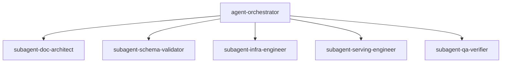

# Multi-Agent Team

The parent session is `agent-orchestrator`. It coordinates phased execution, verifies gate pass criteria, and manages inter-agent artifacts. Specialist subagents execute the paths where they are Responsible.

## Roles

| Role                          | Designation                 | Primary responsibilities                                                                                               |
| ----------------------------- | --------------------------- | ---------------------------------------------------------------------------------------------------------------------- |
| Lead Orchestrator             | `agent-orchestrator`        | Coordinates phased execution, verifies gate pass criteria, manages inter-agent artifacts.                              |
| Documentation Architect       | `subagent-doc-architect`    | Manages `mkdocs.yml`, layouts, navigation hierarchy, admonitions, and Executive/Architect tracks.                      |
| Research and Schema Validator | `subagent-schema-validator` | Validates API versions, CRDs (Gateway API, KServe, Kuadrant, NVIDIA), and hardware constraints.                        |
| Platform and Infra Engineer   | `subagent-infra-engineer`   | Produces Day 0/Day 1 manifests: GPU Operator, MIG ConfigMaps, time-slicing, ODF/CephFS, Kueue.                         |
| MLOps and Serving Engineer    | `subagent-serving-engineer` | Produces KServe InferenceServices, vLLM flags, audio pipelines, Model Registry, Kuadrant MaaS Gateway.                 |
| QA and Verification Engineer  | `subagent-qa-verifier`      | Writes Python/cURL verification suites, failure injection tests, troubleshooting guides, runs `mkdocs build --strict`. |

## RACI

`agent-orchestrator` is Accountable for every gate. One Responsible writer owns each path. Roles that are not Accountable, Responsible, or Consulted are Informed through the orchestrator's handoff summary.

| Activity                                                                                             | agent-orchestrator | subagent-doc-architect | subagent-schema-validator | subagent-infra-engineer | subagent-serving-engineer | subagent-qa-verifier |
| ---------------------------------------------------------------------------------------------------- | ------------------ | ---------------------- | ------------------------- | ----------------------- | ------------------------- | -------------------- |
| Scaffold, `mkdocs.yml`, `requirements.txt`, `docs/index.md`, `docs/executive/`, `docs/architecture/` | A                  | R                      | C                         | I                       | I                         | I                    |
| `.cursor/artifacts/technical-schema-reference.md`                                                    | A                  | I                      | R                         | C                       | C                         | I                    |
| `docs/platform-prerequisites/`, `docs/gpu-partitioning/`                                             | A                  | I                      | C                         | R                       | I                         | I                    |
| `docs/model-serving/`, `docs/maas-governance/`, `docs/workflows/`                                    | A                  | I                      | C                         | C                       | R                         | I                    |
| `docs/verification/`, `docs/operations/`, `mkdocs build --strict`                                    | A                  | C                      | I                         | I                       | C                         | R                    |
| Gate sign-off                                                                                        | A, R               | I                      | I                         | I                       | I                         | I                    |

The schema reference is an inter-agent artifact and stays out of the MkDocs nav. Infra and serving are Consulted while it is written so the reference covers their constraints. The schema validator is Consulted for architecture facts on the executive and architecture pages.

Gate sign-off uses evidence from the Responsible writer for that deliverable. Phase 6 `mkdocs build --strict` is Responsible `subagent-qa-verifier` and Accountable `agent-orchestrator`.

## Write lanes

Write only the paths where your designation is Responsible.

- `agent-orchestrator`: coordination, gate records, and handoff summaries. Specialist files stay with the Responsible subagent.
- `subagent-doc-architect`: `mkdocs.yml`, `requirements.txt`, `docs/index.md`, `docs/executive/`, `docs/architecture/`.
- `subagent-schema-validator`: `.cursor/artifacts/technical-schema-reference.md`.
- `subagent-infra-engineer`: `docs/platform-prerequisites/`, `docs/gpu-partitioning/`.
- `subagent-serving-engineer`: `docs/model-serving/`, `docs/maas-governance/`, `docs/workflows/`.
- `subagent-qa-verifier`: `docs/verification/`, `docs/operations/`.

A defect outside the current lane goes back to the orchestrator, which assigns the fix to the Responsible writer.

## Gates

| Gate | Responsible evidence                                                                                                                                                 |
| ---- | -------------------------------------------------------------------------------------------------------------------------------------------------------------------- |
| 1    | `subagent-doc-architect`: `mkdocs build` completes with zero syntax errors after scaffold.                                                                           |
| 2    | `subagent-schema-validator`: schema reference includes zero deprecated APIs and confirms `--kv-cache-dtype fp8` and `--tensor-parallel-size 4`.                      |
| 3    | `subagent-doc-architect`: executive pages state GPU utilization ROI, multi-tenant isolation, zero-replica failover cost, and latency profiles.                       |
| 4    | `subagent-infra-engineer`: every manifest includes `metadata.namespace`, pod `spec.template` where the resource has one, labels, annotations, and zero placeholders. |
| 5    | `subagent-serving-engineer` and `subagent-qa-verifier`: Python, cURL, and failover runbooks pass dry-run lint.                                                       |
| 6    | `subagent-qa-verifier`: `mkdocs build --strict` exits 0.                                                                                                             |

## Shared mandates

- Zero placeholders. Never use `# <insert config here>`, `TODO`, or ellipses. Every YAML manifest, cURL command, and Python script must be fully populated and syntactically valid.
- Dual-audience separation. Files under `docs/executive/` cover business value, TCO savings of zero-replica failover, SLA tiers, and high-level Mermaid architecture diagrams. Files under `docs/model-serving/`, `docs/gpu-partitioning/`, and `docs/platform-prerequisites/` provide verbatim CLI commands and production Kubernetes manifests.
- High availability. The single-replica flagship model specifies 10s eviction tolerations for `node.kubernetes.io/not-ready` and `node.kubernetes.io/unreachable`. Use `flagship-critical-priority` (value `1000000000`) with `PreemptLowerPriority`. Model storage mounts use CephFS `ReadWriteMany` (RWX) PVCs.
- MkDocs strict compliance. Markdown links resolve locally so `mkdocs build --strict` succeeds.

## Handoff evidence

End every specialist task with:

- Designation
- Files written
- Commands run and exit codes
- Gate criteria met or unmet
- Consulted inputs used
- Defects that belong to another lane
