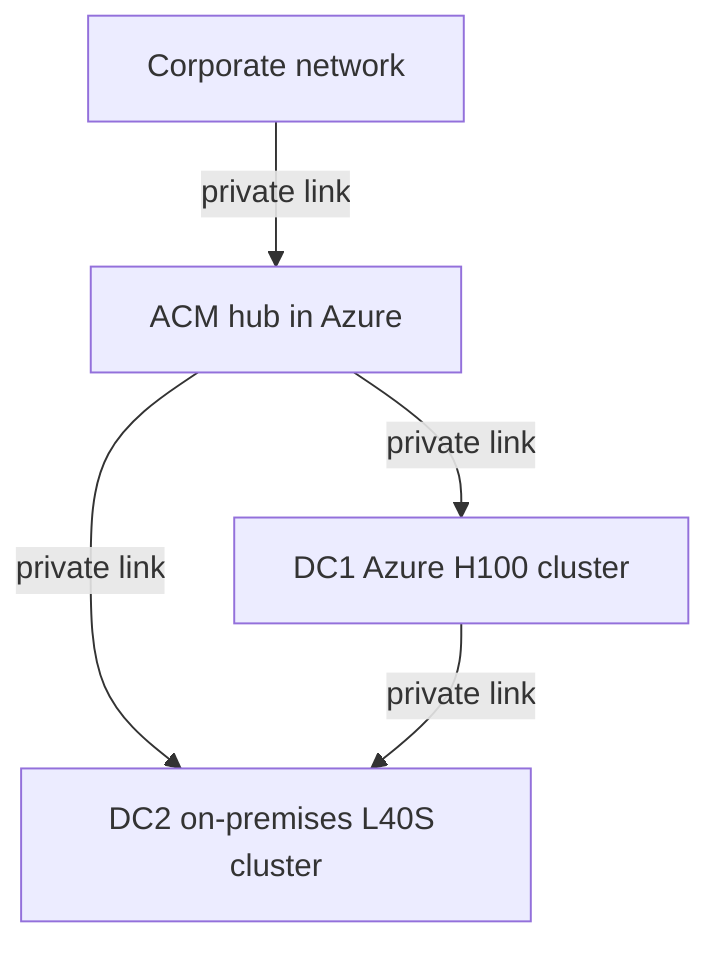
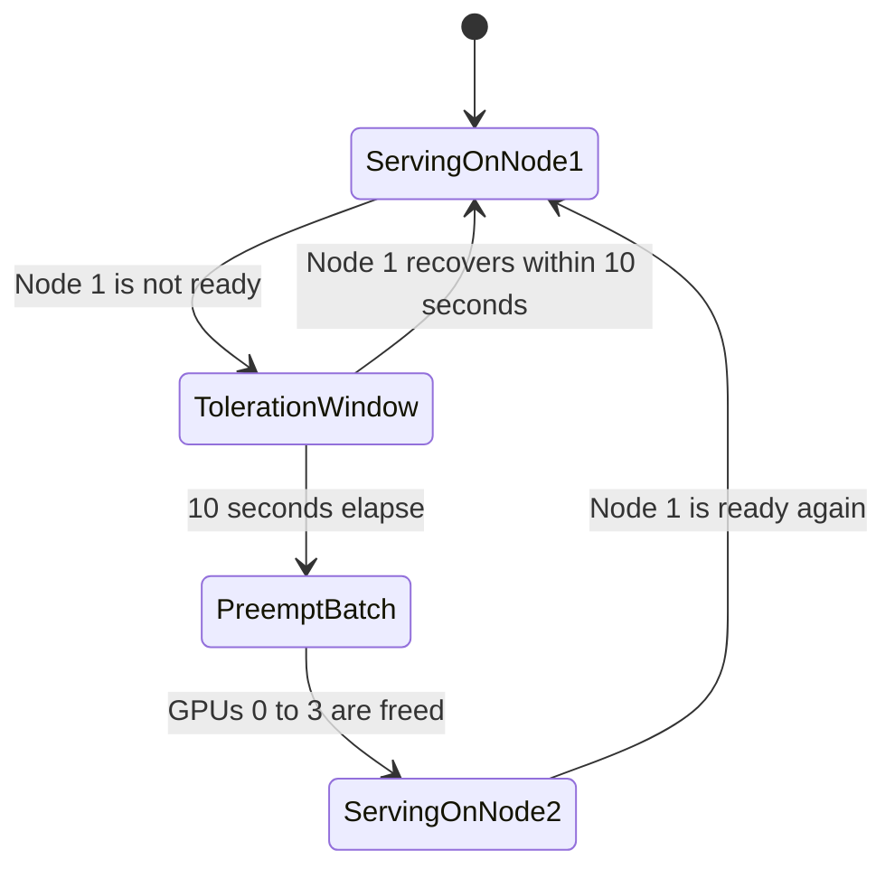

# Global topology

Three OpenShift clusters form the platform. The Advanced Cluster Management hub in Azure is the only cluster that publishes the AI gateway. Data center 1 and data center 2 are managed clusters. Private links connect the hub to each data center, and the data centers to each other. Corporate users reach the hub gateway over a private link. The gateway has no internet listener.

| Cluster | Where it runs          | Role                                                                      |
| ------- | ---------------------- | ------------------------------------------------------------------------- |
| ACM hub | Azure                  | Cluster management, Gateway API entry, authentication, and rate limits    |
| DC1     | Azure                  | Flagship 72B model on H100 GPUs, local CephFS weights                     |
| DC2     | On-premises bare metal | Speech, text-to-speech, and embeddings on L40S GPUs, local CephFS weights |

The hub does not schedule GPU pods and does not store model weights. Inference backends stay on the private links. They are not separately published to the corporate network or to the internet.

Authoring APIs for the later manifests are recorded in the technical schema reference used by the platform and serving authors: InferenceService `serving.kserve.io/v1beta1`, Gateway and HTTPRoute `gateway.networking.k8s.io/v1`, and AuthPolicy and RateLimitPolicy `kuadrant.io/v1`.

## Request path

A corporate client calls the hub. The hub authenticates the caller and applies the quota for that tier, then forwards the path:

- `/v1/chat/completions` to the flagship replica in data center 1.
- `/v1/audio/transcriptions` to Whisper in data center 2.
- `/v1/audio/speech` to text-to-speech in data center 2.
- `/v1/embeddings` to the embedding runtime in data center 2.

The [gateway page](maas-gateway-kuadrant.md) draws that tree. The [storage page](storage-networking.md) explains why the model bytes do not follow those private links on the request path.

## Flagship failover

Failover is a reschedule inside data center 1. Node 1 serves the replica on four full H100 GPUs. If that virtual machine stays not ready or unreachable for 10 seconds, the scheduler preempts batch work on GPUs 0 through 3 of node 2 and starts the same single replica there. Both virtual machines mount the data center 1 CephFS volume, so the start does not download weights across a private link.

## Latency bands

- Tensor parallel for the flagship uses NVLink inside one H100 virtual machine. NVIDIA publishes 900 GB/s NVLink for the H100 SXM.
- Failover uses the two H100 virtual machines and the local CephFS volume in data center 1.
- Speech and embeddings cross a private link from the hub to data center 2 after the client has already crossed the corporate private link to the hub.

This page does not assign millisecond budgets to those bands.
