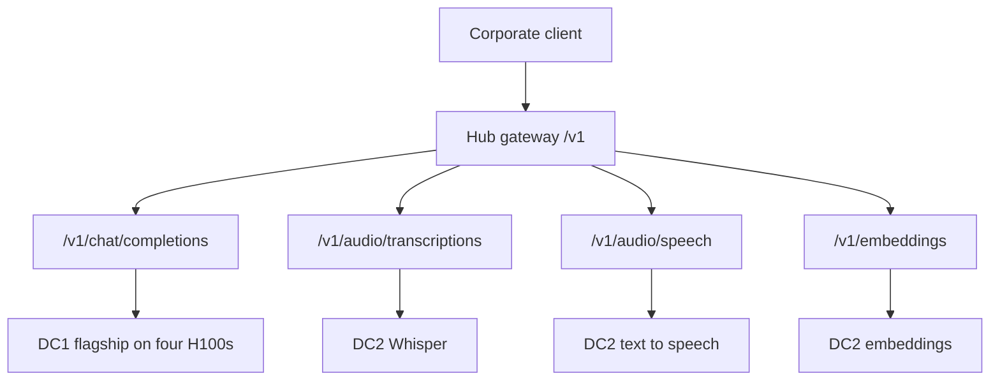

# MaaS gateway

The single OpenAI-compatible gateway runs on the Advanced Cluster Management hub in Azure. Corporate clients reach it over a private link. The gateway has no internet listener. Data center inference services are backends on private links. They are not a second public API.

Authentication and rate limits use Connectivity Link 1.4. The authoring API is `kuadrant.io/v1` for both `AuthPolicy` and `RateLimitPolicy`. `kuadrant.io/v1beta2` is rejected. Policies attach to a Gateway API `Gateway` or `HTTPRoute` at `gateway.networking.k8s.io/v1`, which requires Gateway API 1.2 or later on this platform. The policy `targetRef.group` is `gateway.networking.k8s.io`.

## Routing tree

| Path                       | Backend                                          | Site                                               |
| -------------------------- | ------------------------------------------------ | -------------------------------------------------- |
| `/v1/chat/completions`     | Flagship 72B replica, one pod, tensor parallel 4 | DC1 H100 node 1, or node 2 GPUs 0-3 after failover |
| `/v1/audio/transcriptions` | Whisper                                          | DC2 L40S                                           |
| `/v1/audio/speech`         | Text-to-speech                                   | DC2 L40S                                           |
| `/v1/embeddings`           | Embedding runtime                                | DC2 L40S                                           |

## Isolation

The hub is the enforcement point for identity and for request-rate and token-rate tiers. API-key and OIDC authentication both terminate there. A caller who can reach a data center network still needs a policy that allows the path. The gateway is the published contract.

MIG isolation on data center 1 node 2 is independent of the gateway. It limits which GPU memory a smaller model can see. L40S time-slicing does not add that hardware boundary. Quotas on the hub and the queue on the cluster are the controls for that fleet.

Production Gateway, HTTPRoute, AuthPolicy, and RateLimitPolicy manifests belong to the later MaaS governance pages. This page fixes the topology those manifests must implement: one internal listener on the hub, four paths, and private backends.
