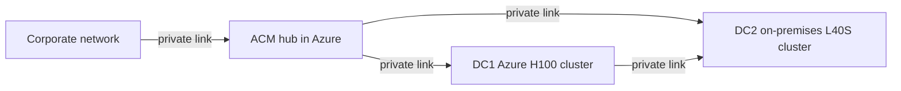
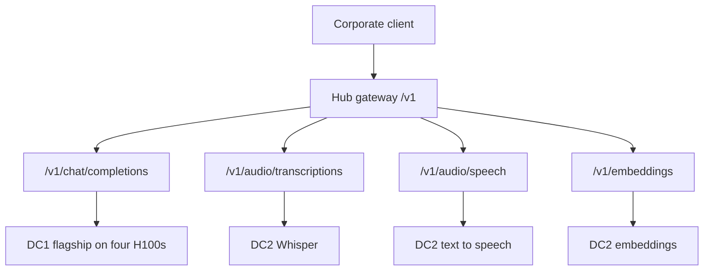

# Executive summary

Red Hat OpenShift AI hosts one internal Models-as-a-Service platform for the corporate network. A Red Hat Advanced Cluster Management hub in Azure publishes the only AI gateway. Data center 1, also in Azure, serves the flagship 72B model on NVIDIA H100 GPUs. Data center 2, on premises, serves speech, text-to-speech, and embeddings on NVIDIA L40S GPUs.

The gateway is reachable from the corporate network over a private link. It has no internet listener. Private links also connect the hub to each data center, and the two data centers to each other.

## What each site is for

The hub is the control and entry cluster. It authenticates callers, applies request and token quotas, and routes OpenAI-compatible paths. It does not run model weights.

Data center 1 keeps one replica of the flagship model on four H100 GPUs inside a single Azure virtual machine. A second, identical virtual machine holds spare full GPUs for failover and smaller MIG-backed workloads. Three additional Azure workers have no GPUs. They carry platform services and the local weight store.

Data center 2 runs Whisper transcription, text-to-speech, and embeddings. Those models share L40S GPUs with time-slicing and can scale to zero when idle.

## Routing

## Why this shape

One flagship replica avoids paying for a second hot copy of a 72B model. Failover stays inside data center 1, on GPUs that already belong to the platform. Speech and embeddings stay on the less expensive L40S fleet. Callers see one internal `/v1` endpoint.

The [business value and cost](business-value-tco.md) page states the four-H100 saving and the utilization target. The [service levels](sla-dr-strategy.md) page states the failover and latency bands. The [global topology](../architecture/global-topology.md) page is the engineering view of the same layout.
