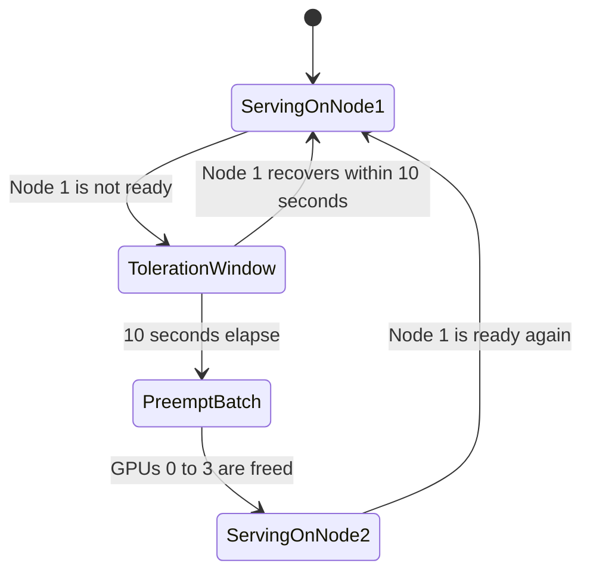

# Service levels and disaster recovery

Service levels follow the path a caller uses and the GPU pool behind it. Recovery of the flagship stays inside data center 1. Data center 2 does not become a second home for the 72B model.

## Tiers

| Tier                  | Who it serves                           | Protection                                                                   | What can interrupt it                               |
| --------------------- | --------------------------------------- | ---------------------------------------------------------------------------- | --------------------------------------------------- |
| Flagship interactive  | `/v1/chat/completions` on four H100s    | Single replica, 10-second node-failure toleration, priority above batch work | Loss of DC1 node 1, recovered onto DC1 node 2       |
| Speech and embeddings | Audio and embedding paths on L40S GPUs  | Separate site and local weights; idle replicas may scale to zero             | DC2 capacity and the private link from the hub      |
| Batch and training    | Preemptable jobs on DC1 node 2 GPUs 0-3 | Best effort on GPUs reserved for flagship failover                           | Flagship preemption, without a completion guarantee |

The flagship priority class is `flagship-critical-priority` at value `1000000000`, with permission to preempt lower-priority pods. Batch work uses `batch-low-priority` at value `10000`. When node 1 is lost, the flagship takes GPUs 0 through 3 on node 2 and the batch pods on those GPUs stop.

The recovery target exercised by the later node-failure test is restoration of the flagship endpoint in under 60 seconds. The 10-second toleration is the time the scheduler waits before treating the node as gone. It is not, by itself, the full user-visible recovery time.

## Failover inside data center 1

Both H100 virtual machines mount the same data center 1 CephFS volume. The replica starts on node 2 with weights already local. A private link to data center 2 is not on this recovery path.

Multi-tenant isolation on the spare H100s is MIG. GPUs 4 through 7 stay partitioned as one `3g.40gb` instance and four `1g.10gb` instances per GPU, including while the flagship occupies GPUs 0 through 3. Callers are isolated at the hub gateway, which is the only published endpoint and which admits only corporate-network clients.

## Latency bands

The guide does not publish a measured millisecond budget. It distinguishes three bands:

- Flagship tensor parallel uses NVLink inside one H100 virtual machine.
- Flagship failover uses the two H100 virtual machines in data center 1, with weights already on that site's CephFS volume.
- Speech and embeddings travel from the corporate network to the hub, then over a private link to data center 2.

Losing the private link to data center 2 removes speech and embeddings. It does not, by itself, remove the flagship, because that path stays on the hub-to-DC1 private link. Losing the hub, or the corporate private link into the hub, removes every path, because the gateway is the only front door.

## What disaster recovery does not do

Data center 2 is not a flagship disaster-recovery site. L40S memory bandwidth and capacity are the wrong fit for a 72B replica, and the design does not pay for a second hot replica in either site. Weight seeding into each site's own CephFS volume keeps inference off the cross-site link. It is not a stretched storage cluster.
